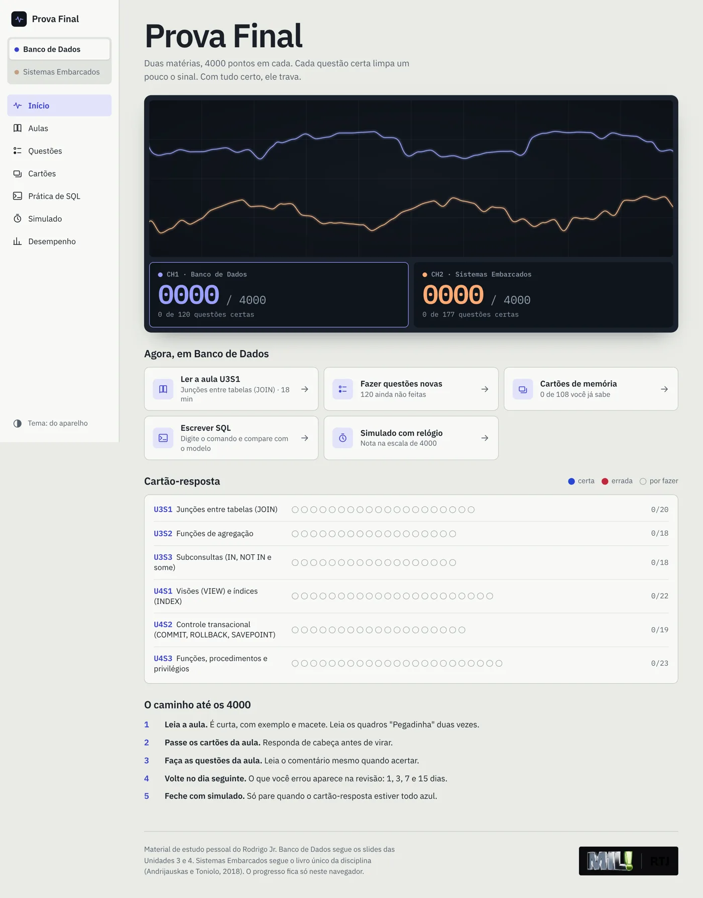
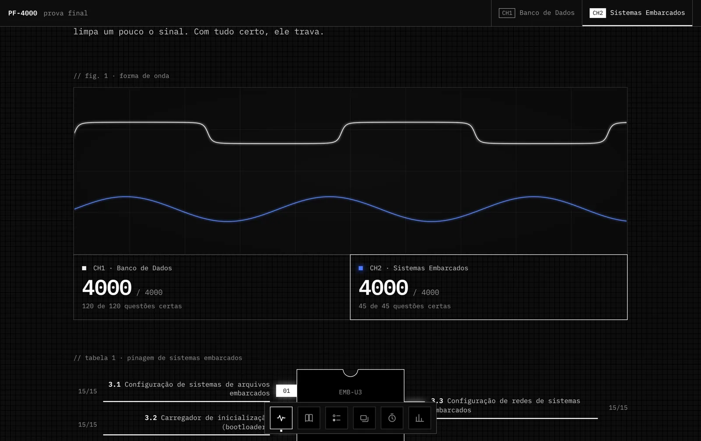

# Cartão-Resposta: Prova Final

Minha folha de dados de estudo para a prova final de duas matérias da faculdade: **Programação em Banco de Dados** e **Sistemas Embarcados**. A ideia de estudar por questões vem do meu [Cartão-Resposta](https://github.com/Toshiro01001/Cartao-Resposta), mas aqui o visual e a estrutura são outros: o site parece a folha de dados de um componente eletrônico.

**Abrir o site:** https://toshiro01001.github.io/Cartao-Resposta-ProvaFinal/

## O que tem

| | Banco de Dados | Sistemas Embarcados |
|---|---|---|
| Aulas | 6 | 12 |
| Questões comentadas | 120 | 177 |
| Cartões de memória | 108 | 215 |
| Prática de SQL | 54 | não tem |

## Como funciona

- **Início:** uma folha de dados. A Figura 1 é um osciloscópio com um canal por matéria: cada questão certa limpa o sinal e, com tudo certo, ele trava e o placar marca 4000. A Tabela 1 é a pinagem de um chip: cada pino é uma seção da matéria e acende quando eu acerto todas as questões dela.
- **Menu:** uma barra no pé da tela. No computador os ícones crescem sob o mouse; no celular vira um botão que abre a lista.
- **Aulas:** curtas, com exemplo, tabela, macete e pegadinha.
- **Cartões:** pergunta na frente, resposta atrás, num cartão que inclina e brilha sob o mouse. O que eu não sabia volta no dia seguinte.
- **Questões:** cinco alternativas com comentário. O que eu erro volta na revisão (1, 3, 7 e 15 dias).
- **Prática de SQL:** digito o comando e comparo com o modelo.
- **Simulado:** questões sorteadas, com relógio e nota na escala de 4000.
- **Desempenho:** pontuação por matéria e um código para levar o progresso de um aparelho para outro.

## Para quem entende de programação

- A página chega aqui já compilada (React + WebGL, com a biblioteca Motion na barra do menu). `index.html` carrega o programa e o estilo de `assets/`. Esses arquivos não são editados à mão.
- O progresso fica só no navegador (`localStorage`). O site não conversa com nenhum outro endereço e tem Content-Security-Policy restritiva: sem CDN, sem fonte externa, sem script ou estilo inline.
- Sem WebGL, ou com "reduzir movimento" ligado, o osciloscópio vira um desenho parado.
- Teste: sirva esta pasta na porta 8321 e rode `node tests/site.cjs`.
- Fonte IBM Plex Mono (licença OFL), React e Motion (licença MIT), em `licencas/`.
- Visual feito com o estilo Artefakt, do GetLayers, e com os componentes Floating Dock e Holo Card, do ProfitizeBuild, adaptados por mim.

## Aviso

É material de estudo pessoal. As questões foram escritas a partir dos slides e do livro da disciplina; o livro não traz gabarito, então algumas respostas foram tiradas do texto e estão marcadas com um aviso na tela.
